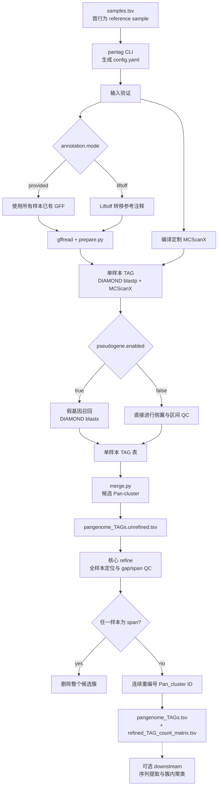

# Pan-TAG v0.1

Pan-TAG 是一个基于 Snakemake 的泛基因组串联重复基因簇（tandemly arrayed genes，TAG）识别与跨样本整合工具。它接收同一物种的多个基因组组装及其注释，完成单样本 TAG 识别、可选假基因召回、基于成员和侧翼共线性的跨样本合并，并生成统一的 Pan-TAG 表。

核心输出为：

```text
results/local_tags/<sample_id>_TAGs.tsv
results/global/pangenome_TAGs.tsv
results/global/refined_TAG_count_matrix.tsv
```

核心 refine 会在所有样本重新定位候选簇；仅当出现跨多个 seqid 的 `span` 样本比例严格大于 0.9 时删除整个候选簇，并将统计信息直接合并进计数矩阵。可选下游继续生成逐 Pan-cluster FASTA 及簇内 k-mer 聚类。当前 v0.1 已在人类 GENCODE/Liftoff 注释体系上完成实际数据测试，并提供可配置的 GFF 属性解析；这不代表已经对所有物种和注释来源完成 benchmark。

## 工作流程



默认 Snakemake 目标 `all` 必经 merge 和 refine，并同时生成正式 Pan-TAG 表与计数矩阵。序列提取和聚类只有在用户指定相应 downstream 目标时才运行。

## 系统要求与安装

### 支持环境

- Linux x86-64；`pixi.toml` 声明的兼容基线为 Linux 3.10、glibc 2.17。
- [Pixi](https://pixi.sh/) 用于安装和运行全部依赖。
- 默认环境固定使用 Python 3.12，并包含 Snakemake、DIAMOND、gffread、Biopython、pysam、PyYAML、NumPy、SciPy、Matplotlib 3.9 和 C++ 编译器。Python 与 Matplotlib 的版本约束用于兼容 glibc 2.17 集群并避免 Python 3.14 的 `cp314`/`cp314t` ABI 冲突。`pysam` 只由 `pixi.toml` 的 conda/bioconda 依赖提供，不在 editable PyPI 包中重复声明，以避免在老集群上源码编译 HTSlib。
- `liftoff` 模式额外使用项目定义的独立 Pixi 环境 `liftoff`。工作流直接调用项目目录下已安装的 `.pixi/envs/liftoff/bin/liftoff`，不会在计算节点再次求解或下载依赖。
- 定制 MCScanX 不需要用户预先安装；工作流从 `src/pantag/mcscanx/MCScanX-source.tar.gz` 编译。

> Note: 当前 `pixi.toml` 只声明 `linux-64`，不支持直接在 Windows 或 macOS 上执行正式工作流。

### 获取项目并安装

进入项目根目录：

```bash
cd <PROJECT_DIR>
```

安装或更新默认环境：

```bash
pixi install
```

如果准备使用 Liftoff，再安装 Liftoff 环境：

```bash
pixi install --environment liftoff
```

以上安装必须在可以访问 conda/PyPI 的登录节点完成。HPC 计算节点只执行已经安装的环境；不要在计算任务中运行 `pixi install`，也不要依赖嵌套的 `pixi run --environment liftoff`。

检查安装和命令入口：

```bash
pixi run pantag --version
pixi run pantag -h
pixi run snakemake --version
pixi run diamond version
pixi run gffread --version
```

预期结果是各命令正常打印版本或帮助信息。`provided` 模式不要求 Liftoff 环境可用。

## 输入文件准备

### FASTA

每个 `sample_id` 必须提供一份基因组组装 FASTA。建议：

- 使用绝对路径，或使用相对于项目运行目录的路径；
- FASTA 序列名必须与对应 GFF3 第一列 `seqid` 完全一致；
- 不要在一次分析中混入不同物种；
- 参考样本 FASTA 和 GFF3 必须来自同一组装版本。

工作流会在核心 refine 前通过独立 `fasta_indexes` 规则为每份 FASTA 建立 `.fai`，统一保存到
`<work_dir>/fasta_indexes/<sample_id>.fai`。refine 显式读取这些索引，不会在原始 FASTA 旁写入
文件，因此输入 FASTA 及其所在目录可以是只读的。

### GFF3

Pan-TAG 支持两种全局注释模式，不能在同一次运行中混用：

- `provided`：reference sample 和所有目标样本都必须提供 GFF3。
- `liftoff`：只有 `samples.tsv` 首行的 reference sample 提供 FASTA 和 GFF3；所有后续目标样本仅提供 FASTA，GFF 字段留空。工作流执行 `liftoff <target.fa> <reference.fa> -g <reference.gff>`。

GFF3 必须满足以下条件：

- 普通基因流程只读取 `annotation.gene_feature_types`，默认 `[gene]`；prepare 和核心 refine 不使用假基因候选类型。
- 假基因召回先用 `annotation.pseudogene_feature_types` 限定允许检查的基因级第三列类型，默认 `[gene, pseudogene]`，然后必须再由 biotype 属性判定为假基因。
- transcript 记录由 `annotation.transcript_feature_types` 识别，默认 `[mRNA, transcript]`。
- Pan-TAG 当前没有单独的 `CDS feature type` 配置项；CDS/exon 等子级记录由 gffread 按标准 GFF3/GTF 结构解释。若注释使用非标准 CDS 类型，应先转换为 gffread 可识别的格式。
- gene ID、gene name、transcript ID 和 transcript→gene 父子关系可由配置的候选属性键解析。
- gffread 能依据 transcript/CDS/exon 结构从 FASTA 翻译蛋白；Pan-TAG 最终只保留至少有一条有效翻译蛋白的 gene。
- gene/transcript 坐标合法，且 GFF3 `seqid` 存在于对应 FASTA。
- 如果使用 biotype 筛选，相关属性和值应能由 `biotype_keys` 和 `coding_values` 匹配。

默认属性配置为：

```yaml
annotation:
  gene_feature_types: [gene]
  pseudogene_feature_types: [gene, pseudogene]
  transcript_feature_types: [mRNA, transcript]
  gene_id_keys: [gene_id, ID]
  gene_name_keys: [gene_name, Name, gene_symbol, gene, geneName]
  transcript_id_keys: [transcript_id, ID]
  transcript_parent_gene_keys: [gene_id, Parent]
  biotype_keys: [gene_type, gene_biotype, biotype]
  coding_filter_mode: auto
  coding_values: [protein_coding]
  excluded_attribute_terms: [readthrough_gene, readthrough]
  pseudogene_values: [pseudogene, processed_pseudogene, unprocessed_pseudogene]
  strip_id_prefixes: ["gene:", "transcript:"]
  fallback_gene_name_to_id: true
```

例如，植物 GFF3 常用 `ID/Name/Parent`，可在自定义模板中明确设置：

```yaml
annotation:
  gene_id_keys: [ID]
  gene_name_keys: [Name]
  transcript_id_keys: [ID]
  transcript_parent_gene_keys: [Parent]
```

`coding_filter_mode` 的含义：

| 值 | 行为 |
|---|---|
| `auto` | 检测到匹配 `coding_values` 的 gene biotype 时按 biotype 筛选；否则退回有效翻译蛋白判定 |
| `biotype` | 强制只保留 biotype 匹配 `coding_values` 的 gene |
| `translated_protein` | 忽略 biotype，只按是否具有有效翻译蛋白筛选 |

`excluded_attribute_terms` 对整段 gene 属性执行不区分大小写的包含匹配，可用于排除 readthrough gene。

假基因候选采用两级判断：

```text
is_pseudo = (GFF 第三列属于 pseudogene_feature_types)
            AND (gene_type/gene_biotype/biotype 表示 pseudogene)
```

因此既支持人类常见的 `feature=gene; gene_type=processed_pseudogene`，也支持小鼠常见的
`feature=pseudogene; biotype=processed_pseudogene`。`feature=gene` 但 biotype 为
`protein_coding` 的记录不会成为假基因候选。默认不包含 `pseudogenic_transcript`，避免同一
假基因同时按 gene-level 和 transcript-level 记录读取。

> Warning: GFF3 能被读取不等于注释映射正确。首次使用新的注释来源时，应检查 `work/<sample>/<sample>.map` 和 `work/<sample>/<sample>_prepare_qc.tsv` 中的 gene ID/name、蛋白映射和过滤计数。

### `samples.tsv`

`samples.tsv` 必须：

- 有表头；
- 恰好三列，列名和顺序必须为 `sample_id`、`fasta`、`gff`；
- 使用制表符分隔，不是空格；
- 第一条数据必须是 reference sample；
- `sample_id` 必须非空且唯一。

代码目前不额外限制 `sample_id` 字符集，但它会进入目录名和文件名。建议仅使用字母、数字、点、下划线和连字符，避免空格、斜杠和 shell 特殊字符。

`provided` 模式示例：

```text
sample_id	fasta	gff
reference	/data/reference.fa	/data/reference.gff3
sample01	/data/sample01.fa	/data/sample01.gff3
sample02	/data/sample02.fa	/data/sample02.gff3
```

`liftoff` 模式示例；目标样本第三列为空，但结尾制表符必须保留：

```text
sample_id	fasta	gff
reference	/data/reference.fa	/data/reference.gff3
sample01	/data/sample01.fa	<empty>
sample02	/data/sample02.fa	<empty>
```

上面的 `<empty>` 仅用于直观表示空字段；实际 TSV 中应删除该文字并保留字段前的制表符。

> Warning: `liftoff` 模式不允许目标行提供 GFF；`provided` 模式不允许任何目标行缺少 GFF。

## 快速开始：最小完整示例

以下示例假设用户已经为全部样本准备 GFF3。

### 1. 进入项目并安装环境

```bash
cd <PROJECT_DIR>
pixi install
```

预期结果是创建或更新项目的 `.pixi` 环境。

### 2. 准备输入目录

将 FASTA/GFF3 放到稳定位置，例如 `<PROJECT_DIR>/input/`。不要在运行过程中移动这些文件。

### 3. 创建样本表

创建 `<SAMPLES_TSV>`，例如 `config/my_samples.tsv`：

```text
sample_id	fasta	gff
reference	/absolute/path/reference.fa	/absolute/path/reference.gff3
sample01	/absolute/path/sample01.fa	/absolute/path/sample01.gff3
```

### 4. 生成独立配置

`--annotation-mode` 和假基因开关都是必填项。以下命令使用已有 GFF，并关闭假基因召回：

```bash
pixi run pantag configure \
  --samples <SAMPLES_TSV> \
  --annotation-mode provided \
  --no-pseudogene-enabled \
  --output-config config/my_run.yaml
```

预期生成 `config/my_run.yaml`。如需假基因召回，将 `--no-pseudogene-enabled` 改为 `--pseudogene-enabled`。

### 5. 检查最终配置与 DAG

先查看最终有效配置：

```bash
sed -n '1,240p' config/my_run.yaml
```

再进行 dry-run：

```bash
pixi run snakemake all \
  --snakefile workflow/Snakefile \
  --configfile config/my_run.yaml \
  --dry-run \
  --printshellcmds
```

预期输出任务列表但不执行任务。`provided` 模式下任务列表不应包含 `liftoff`；关闭假基因召回时不应包含 `retrieve_pseudogenes`。

### 6. 运行核心流程

将 `<THREADS>` 替换为当前机器允许使用的总核心数：

```bash
pixi run snakemake all \
  --snakefile workflow/Snakefile \
  --configfile config/my_run.yaml \
  --cores <THREADS> \
  --printshellcmds \
  --show-failed-logs \
  --rerun-incomplete \
  --latency-wait 60
```

预期生成 `<RESULTS_DIR>/local_tags/`、`<RESULTS_DIR>/global/pangenome_TAGs.tsv` 和
`<RESULTS_DIR>/global/refined_TAG_count_matrix.tsv`。默认 `<RESULTS_DIR>` 为 `results`。

### 7. 查看结果和日志

```bash
head -n 5 <RESULTS_DIR>/global/pangenome_TAGs.tsv
head -n 5 <RESULTS_DIR>/global/refined_TAG_count_matrix.tsv
find logs -maxdepth 2 -type f -print
```

失败时优先查看 Snakemake 报出的具体 rule 日志，而不是只查看总提交日志。

## 配置文件与参数优先级

默认模板为 `config/config.yaml`。`pantag configure` 只负责读取样本表、合并配置并写出 YAML；它不会执行 Snakemake。

`config/config.yaml` 是所有用户可调运行参数的唯一来源。Snakefile 只读取并传递这些值，执行模块不再为同一参数设置第二套默认值；缺少必需配置项时流程会直接报错，不会静默采用代码内置值。通常应通过 `pixi run pantag configure ...` 基于项目的完整模板生成配置，而不是直接调用各 Python 执行模块。

- `--template <FILE>`：选择一个现有 YAML 作为模板；默认 `config/config.yaml`。
- `--output-config <FILE>`：写出最终配置；等价别名为 `--output`，默认 `config/config.yaml`。
- 未在 CLI 显式提供的可选值保留所选模板中的值。
- CLI 显式值覆盖模板中的对应值。

```text
最终值 = 显式 CLI 参数；否则使用所选模板中的值
```

建议每个数据集保留独立配置，避免覆盖默认模板：

```bash
pixi run pantag configure \
  --samples config/dataset_A.samples.tsv \
  --annotation-mode provided \
  --pseudogene-enabled \
  --template config/config.yaml \
  --output-config config/dataset_A.yaml
```

查看所有可配置参数及当前默认模板中的值：

```bash
pixi run pantag -h
```

> Note: `pantag configure` 和省略 `configure` 的 `pantag` 写法等价。为便于阅读，本文统一使用 `pantag configure`。

### 必需 CLI 参数

| 参数 | 含义 |
|---|---|
| `--samples` | 三列样本表 |
| `--annotation-mode {provided,liftoff}` | 全局注释模式 |
| `--pseudogene-enabled` 或 `--no-pseudogene-enabled` | 显式开启或关闭假基因召回 |

### 常用可选参数

默认值均来自当前 `config/config.yaml`。

| 参数 | 当前默认值 | 作用 |
|---|---:|---|
| `--results-dir` | `results` | 正式结果目录 |
| `--logs-dir` | `logs` | 日志目录 |
| `--work-dir` | `work` | 中间文件目录 |
| `--diamond-threads` | `4` | 每个 DIAMOND job 的线程数 |
| `--blastp-identity` | `20` | blastp 最低 identity 百分比 |
| `--blastp-query-coverage` | `20` | blastp 最低 query coverage 百分比 |
| `--blastp-subject-coverage` | `20` | blastp 最低 subject coverage 百分比 |
| `--family-merge-strategy` | `first_digit_prefix` | 单样本相邻家族合并策略；跨物种保守使用可选 `none` |
| `--pseudogene-feature-types` | `gene,pseudogene` | 允许进入假基因 biotype 检查的 GFF 第三列类型 |
| `--pseudogene-flank-bp` | `50000` | 假基因候选搜索距离 |
| `--blastx-identity` | `20` | blastx 最低 identity 百分比 |
| `--blastx-query-coverage` | `20` | blastx 最低 query coverage 百分比 |
| `--blastx-subject-coverage` | `20` | blastx 最低 subject coverage 百分比 |
| `--flank-gene-count` | `10` | TAG 每侧用于 QC/共线性的基因数 |
| `--member-overlap-threshold` | `0.30` | local/global TAG 成员重叠阈值 |
| `--require-same-seqid` | `false` | 合并候选是否要求相同 seqid |
| `--debug-outputs` | `false` | 是否发布 `local_to_global.tsv` |
| `--refine-threads` | `12` | 核心 refine 的样本级 worker 上限 |
| `--flank-overlap-threshold` | `0.30` | 候选块自身侧翼中与全局侧翼重叠的最低比例 |

布尔参数使用成对形式，例如 `--require-same-seqid` / `--no-require-same-seqid`。百分比参数范围为 0–100，比例参数范围为 0–1。

## Liftoff 模式

目标样本 GFF 留空后生成配置：

```bash
pixi run pantag configure \
  --samples <SAMPLES_TSV> \
  --annotation-mode liftoff \
  --pseudogene-enabled \
  --output-config config/liftoff_run.yaml
```

安装 Liftoff 环境并 dry-run：

```bash
pixi install --environment liftoff
pixi run snakemake all \
  --snakefile workflow/Snakefile \
  --configfile config/liftoff_run.yaml \
  --dry-run \
  --printshellcmds
```

`pixi install --environment liftoff` 只需在代码目录执行一次。即使使用 `--directory` 在其他数据集目录运行，Snakefile 也会从代码目录的 `.pixi/envs/liftoff/` 调用已安装程序，因此计算节点无需联网。

用户仍只需提供参考 GFF。工作流首先将其构建为一次性复用的
`work/liftoff/reference_annotation.db`，随后所有样本共享该数据库，避免并发重复建库。
实际 Liftoff 参数为：

```text
-db <work/liftoff/reference_annotation.db> -exclude_partial -copies -sc 0.95 -f config/liftoff_features.txt
```

线程数由 `liftoff.threads` 控制，默认 16。输出为 `results/liftoff/<sample_id>/<sample_id>.liftoff.gff3`。

## 运行与恢复

### 总核心数和资源

本地运行用 `--cores <THREADS>` 限制全部任务可同时使用的总核心数。每个 rule 的内存和预计时长位于配置的 `resources` 段；这些值由 Snakefile 读取，不通过 `pantag` CLI 设置。使用集群 executor 时，可据此映射调度器资源。

### 断点续跑

Snakemake 会跳过已存在且最新的输出。任务中断后，使用相同命令并加 `--rerun-incomplete` 即可继续：

```bash
pixi run snakemake all \
  --snakefile workflow/Snakefile \
  --configfile config/my_run.yaml \
  --cores <THREADS> \
  --rerun-incomplete
```

如上一次被强制终止并留下工作目录锁，先确认没有其他 Snakemake 进程在运行，再解锁：

```bash
pixi run snakemake \
  --snakefile workflow/Snakefile \
  --configfile config/my_run.yaml \
  --unlock
```

> Warning: 不要在仍有 Snakemake 任务运行时执行 `--unlock`，也不要让两个工作流同时写入同一组 `results/work/logs`。

### 多数据集并行

同一套 Pan-TAG 安装可以同时运行多个数据集，不需要复制或软链接 `src/`、`workflow/`、
`pixi.toml`。每份配置只需提供互不相同的 `results_dir`、`logs_dir` 和 `work_dir`。
Snakefile 会从安装目录读取程序资源，并把 Snakemake 锁和运行元数据放入该数据集的
`<work_dir>/.snakemake/`；因此不同 `work_dir` 的任务不会争用同一把锁。三个目录既可写绝对
路径，也可写相对于启动目录的路径。

例如同时准备：

```yaml
# config/human.yaml
results_dir: /data/pantag/human/results
logs_dir: /data/pantag/human/logs
work_dir: /data/pantag/human/work
```

```yaml
# config/mouse.yaml
results_dir: /data/pantag/mouse/results
logs_dir: /data/pantag/mouse/logs
work_dir: /data/pantag/mouse/work
```

然后从同一个项目目录启动两条命令即可。不要给两个配置复用任何一个上述目录。

### Slurm 示例

仓库包含面向当前测试集群的 `workflow/pantag_test.sbatch`。提交前应按集群修改 partition、CPU、内存和时限。运行核心流程：

```bash
BASE="$(pwd)"
mkdir -p logs
sbatch \
  --chdir="$BASE" \
  --export=ALL,PANTAG_TARGET=all,PANTAG_CONFIG=config/config.yaml \
  workflow/pantag_test.sbatch
```

脚本根据自身位置确定代码目录，根据 `sbatch --chdir` 确定数据集运行目录，并直接调用代码目录中已安装的 default 环境；不需要设置 `PIXI_BIN`。`PANTAG_CONFIG` 指定本次数据集配置，默认仍为 `config/config.yaml`。SLURM 的总 stdout/stderr
在脚本运行前创建，不受 YAML 中 `logs_dir` 控制；并行提交时用 `sbatch --output` 和
`--error` 将它们放入对应数据集目录。各 rule 的正式日志仍由 `logs_dir` 控制。

## 单独运行可选 downstream

Pan-TAG 没有 `pantag downstream` 子命令。下游通过真实的 Snakemake 目标运行；缺失的上游依赖会自动补跑。

核心 refine 不再是可选 downstream。运行默认 `all` 已生成：

```text
results/global/pangenome_TAGs.tsv
results/global/refined_TAG_count_matrix.tsv
results/downstream/TAG_sequence_manifest.tsv
work/global/refined_cluster_id_map.tsv
work/global/span_removed_clusters.tsv
```

`refine.threads` 控制样本级 worker 数。每个 worker 只顺序扫描一次对应 GFF，并通过
`gene_name → Candidate cluster` 倒排索引分发实际命中；不再划分粗筛窗口。每个 seqid 上的命中形成
一个候选块，块外两侧各读取至多 `flanks.gene_count` 个基因；恢复的全局侧翼比例必须达到
`refine.flank_overlap_threshold`（默认 `0.30`）才是 valid block；评分分母为该样本候选块实际取得的侧翼基因数。

### 1. Sequence extraction：逐 Pan-cluster 序列

- 前置输入：`TAG_sequence_manifest.tsv`、refined matrix、样本 FASTA。
- 上游依赖：会自动补跑包括核心 refine 在内的默认主流程。
- 行为：仅提取 `extraction_eligible=true` 的非 gap、非 span 记录，不重新扫描 GFF。
- 目标：`downstream_sequences`。

```bash
pixi run snakemake downstream_sequences \
  --snakefile workflow/Snakefile \
  --configfile config/my_run.yaml \
  --cores <THREADS>
```

主要输出：

```text
results/downstream/sequences/per_TAG/<global_tag_id>.fa
results/downstream/sequences/sequence_records.tsv
```

即使某个 Pan-cluster 没有 eligible 序列，也会保留对应空 FASTA。

### 2. TAG 内序列聚类和 PCoA

- 前置输入：逐 Pan-cluster FASTA 和 `sequence_records.tsv`。
- 上游依赖：会自动补跑 refine 和 sequence extraction。
- 目标：`downstream_cluster`。
- 并行方式：每个 Pan-cluster 是一个独立 Snakemake job。

```bash
pixi run snakemake downstream_cluster \
  --snakefile workflow/Snakefile \
  --configfile config/my_run.yaml \
  --cores <THREADS>
```

聚类参数：

| 配置项 | 默认值 | 含义 |
|---|---:|---|
| `downstream.cluster.k` | `31` | canonical k-mer 长度 |
| `downstream.cluster.ubiquitous_threshold` | `0.95` | ubiquitous k-mer 频率阈值 |
| `downstream.cluster.max_clusters` | `0` | `0` 表示自动选择候选上限 |
| `downstream.cluster.min_sequences` | `3` | 可聚类所需最少序列数 |
| `downstream.cluster.pcoa` | `true` | 是否生成 PCoA PDF |
| `downstream.cluster.seed` | `1` | 随机种子 |
| `downstream.cluster.pcoa_jitter_frac` | `0.006` | PCoA 点抖动比例 |
| `downstream.cluster.pcoa_point_size` | `4.0` | PCoA 点大小 |
| `downstream.cluster.pcoa_alpha` | `0.25` | PCoA 点透明度 |

主要输出：

```text
results/downstream/clusters/per_TAG/<global_tag_id>/assignments.tsv
results/downstream/clusters/per_TAG/<global_tag_id>/cluster_gene_sample_counts.tsv
results/downstream/clusters/per_TAG/<global_tag_id>/summary.tsv
results/downstream/clusters/per_TAG/<global_tag_id>/pcoa.pdf  # pcoa=true 时
results/downstream/clusters/global_cluster_summary.tsv
```

序列不足或没有可用 k-mer 的单个 Pan-cluster 会记录状态，不会使全部聚类失败。

### 3. 运行全部 downstream

```bash
pixi run snakemake downstream_all \
  --snakefile workflow/Snakefile \
  --configfile config/my_run.yaml \
  --cores <THREADS> \
  --printshellcmds
```

该目标生成序列提取和聚类结果，并自动补跑缺失核心依赖。独立 `summary.py`、`downstream_matrix`、`downstream_summary` 和 `TAG_cluster_summary.tsv` 已删除；基础统计现在位于核心矩阵中。

## 输出说明

### 单样本 TAG 表

路径：`results/local_tags/<sample_id>_TAGs.tsv`。

固定列：

| 列名 | 含义 |
|---|---|
| `Cluster_ID` | 单样本 TAG 标识 |
| `Size` | 去重后的普通成员与召回假基因成员总数 |
| `Chromosome` | TAG 所在 FASTA/GFF seqid |
| `Start` / `End` | 所有最终成员覆盖的 1-based 闭区间 |
| `Length` | `End - Start + 1` |
| `Gene_Density_per_kb` | 最终区间内重叠普通 gene 数量/区间长度 × 1000 |
| `Members_Annotated` | 普通成员 gene name |
| `Members_IDs` | 普通成员 gene ID |
| `Upstream_Genes` / `Downstream_Genes` | 两侧侧翼 gene name，数量由 `flanks.gene_count` 控制 |

当该样本实际召回至少一个假基因时，附加 `Pseudos_Annotated` 和 `Pseudos_IDs`；否则这两列不出现。

### Pan-genome TAG 表

路径：`results/global/pangenome_TAGs.tsv`。

| 列名 | 含义 |
|---|---|
| `global_tag_id` | Pan-cluster ID，例如 `Pan_cluster_0001` |
| `pan_cluster_size` | `gene_names` 中去重后的 gene name 数量 |
| `reference_seqid` | 建立该 Pan-cluster 时的锚点 seqid |
| `source_sample_id` | 该 Pan-cluster 的起始锚点样本 |
| `occupancy` | 至少有一个对应 local TAG 的唯一样本数 |
| `gene_names` | 普通成员和召回假基因名称的去重并集 |
| `gene_ids` | 普通成员和召回假基因 ID 的去重并集 |
| `left_flank_genes` / `right_flank_genes` | 所有合并 local TAG 左/右侧翼名称的分别去重并集 |

`merge.py` 首先在 `work/global/pangenome_TAGs.unrefined.tsv` 中生成连续
`Candidate_cluster_*`，核心 `pantag.refine` 删除 span 样本比例严格大于 0.9 的候选簇后，严格按候选表原始行顺序重新编号为
连续 `Pan_cluster_*`。因此正式 ID 不包含因过滤产生的空号。

### Refined 计数矩阵

路径：`results/global/refined_TAG_count_matrix.tsv`。固定列顺序为：

```text
global_tag_id
gene_names
reference_seqid
detected_sample_count
gap_free_sample_count
gap_free_sample_fraction
gene_count_mean
gene_count_std
gene_count_cv
<samples.tsv 中的所有样本列>
```

样本单元格允许四种形式：`NA` 表示未找到任何目标基因；正整数表示唯一有效区块且区间不含 N；
`N*` 表示唯一有效区块的目标基因区间含 N；`N#` 表示该簇在该样本中存在 span。仅当 span 样本比例
严格大于 0.9 时删除整个候选簇。比例、均值、样本标准差和 CV 固定保留两位小数，且均值、标准差和
CV 只使用无符号正整数单元格。

Matrix notation: `NA` indicates that no target gene was identified in the sample; `*` indicates that the target-gene interval contains one or more ambiguous `N` bases; `#` indicates that the cluster spans multiple flank-supported blocks in that sample.

内部审计文件：

```text
work/global/refined_cluster_id_map.tsv
work/global/span_removed_clusters.tsv
results/downstream/TAG_sequence_manifest.tsv
```

manifest 只含最终保留、单一 valid block、无 gap 的记录，并使用正式 `Pan_cluster_*` ID。
gap、span 和 NA 均不进入 manifest。span 审计始终使用候选 ID；审计表记录 `valid_block_count`、`seqids`、`block_coordinates`、
`refined_count`，且 `reason=MULTIPLE_FLANK_SUPPORTED_BLOCKS`。

当 `outputs.debug: true` 时，另发布：

```text
results/global/local_to_global.tsv
```

若单样本 `results/local_tags/<sample>_TAGs.tsv` 已全部完成，只需重跑 merge、refine 及其核心目标，可使用：

```bash
pixi run snakemake all \
  --snakefile workflow/Snakefile \
  --configfile config/config.yaml \
  --cores <THREADS> \
  --allowed-rules all merge refine \
  --forcerun merge
```

该命令要求已有单样本 TAG 表和 `work/fasta_indexes/*.fai`，并复用样本 FASTA/GFF 与 Liftoff 结果；不会重新执行 Liftoff、gffread、DIAMOND、MCScanX、单样本 TAG 识别、假基因召回或 FASTA 建索引。实际重新运行的工作流规则只有 `merge`、`refine` 和汇总目标 `all`。`merge` 会重新生成 candidate 表，`refine` 随后重新生成正式 Pan-TAG 表、计数矩阵、序列 manifest 和审计文件。

默认关闭 debug 时，该映射仍作为工作流内部文件写入 `work/global/local_to_global.tsv`；它记录
merge 阶段的候选 ID，最终候选到正式 ID 的对应关系见 `refined_cluster_id_map.tsv`。

## 日志和常见问题

### `Nothing to be done`

表示目标输出已经存在且 Snakemake 判断其为最新状态，不是失败。若只是想查看 DAG，可先备份/移走旧结果，或使用 Snakemake 的重跑触发选项；不要在不了解影响时直接删除整个工作目录。

### `Directory cannot be locked`

通常是另一个 Snakemake 正在运行，或被取消的任务留下锁。先检查进程和调度器任务，确认没有运行实例后再执行 `--unlock`。

### provided 模式仍出现 Liftoff

检查最终配置中的：

```yaml
annotation:
  mode: provided
```

同时确认 `samples.tsv` 所有目标行都有 GFF。

### 关闭假基因后仍出现 `retrieve_pseudogenes`

检查最终配置是否为：

```yaml
pseudogene:
  enabled: false
```

然后用相同 `--configfile` 重新 dry-run。

### GFF 生成了输出，但 gene 数量异常少

重点检查：

- FASTA/GFF `seqid` 是否一致；
- `gene_feature_types`、`pseudogene_feature_types`、`transcript_feature_types` 是否匹配第三列；
- ID、Name、Parent 候选键是否匹配第九列；
- `coding_filter_mode` 和 biotype 是否适合当前注释；
- gffread 是否能生成并映射有效蛋白；
- `excluded_attribute_terms` 是否过于宽泛。

### 文件系统延迟导致输出暂时不可见

共享集群文件系统可增加：

```bash
--latency-wait 60
```

## 测试

运行快速单元/模块测试：

```bash
PYTHONPATH=src pixi run python -m unittest discover -s tests -v
```

检查核心 DAG：

```bash
pixi run snakemake all \
  --snakefile workflow/Snakefile \
  --configfile config/config.yaml \
  --dry-run \
  --printshellcmds
```

当前仓库尚未补齐可公开发布的完整迷你端到端 FASTA/GFF 数据，因此实际数据的 dry-run 和集群端到端运行仍是完整工作流验证的一部分。

## Citation

Pan-TAG v0.1 仍在开发中。论文或正式引用信息发布后将在此补充。

## License

项目级许可证尚待最终确认。正式发布和再分发前请补充根目录 `LICENSE`，并保留 `src/pantag/mcscanx/LICENSE` 中的上游许可信息。
